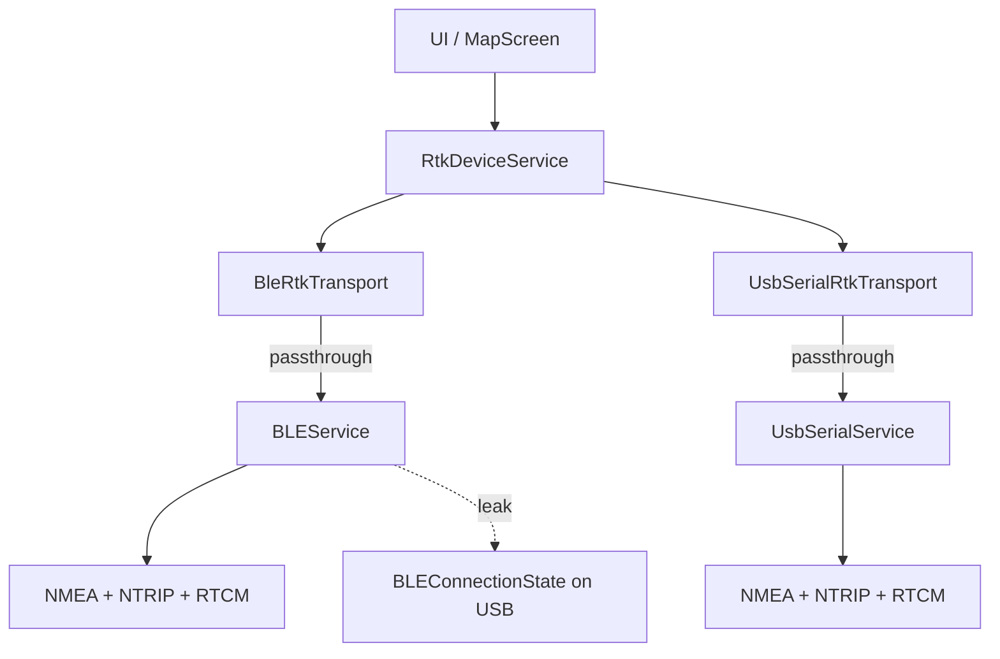
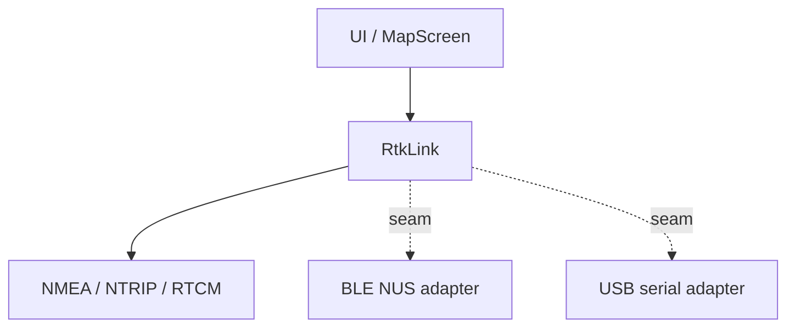
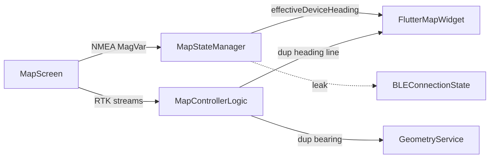
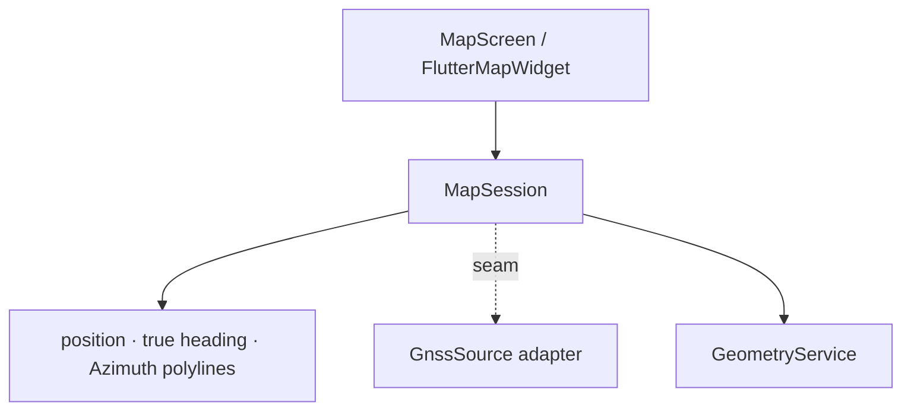
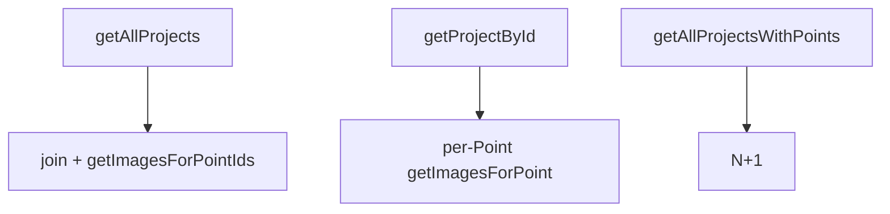
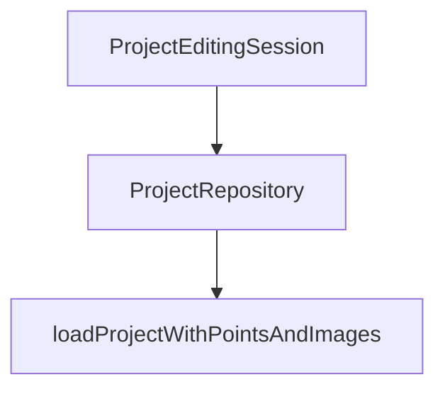

# Architecture review — Teleferika

**Date:** 11 Nov 2026  
**Scope:** hot spots from recent commits — backup, RTK BLE/USB, Project state, map / MagVar, line profile

| Symbol | Meaning |
|--------|---------|
| solid box | module |
| dashed line | seam |
| red / “leak” | leakage across a seam |
| thick / dark | deep module |

Vocabulary: **module**, **interface**, **implementation**, **depth**, **seam**, **adapter**, **leverage**, **locality**.

---

## Candidates

### 1. Deepen the RTK link

**Strength:** Strong · **Category:** ports & adapters

**Files**

- `teleferika.app/lib/ble/rtk_device_transport.dart`
- `teleferika.app/lib/ble/rtk_device_service.dart`
- `teleferika.app/lib/ble/ble_rtk_transport.dart`
- `teleferika.app/lib/ble/usb_serial_rtk_transport.dart`
- `teleferika.app/lib/ble/ble_service.dart` (~1082)
- `teleferika.app/lib/ble/usb_serial_service.dart` (~397)
- `teleferika.app/lib/ble/nmea_parser.dart` · `ntrip_client.dart`

**Before — shallow adapters**

**After — deep RTK link**

| | |
|---|---|
| **Problem** | Two real adapters already exist, but NMEA / NTRIP / RTCM policy is duplicated inside `BLEService` and `UsbSerialService`; the transport modules are shallow passthroughs. |
| **Solution** | Move shared link behaviour behind one deep `RtkLink` interface; leave BLE NUS and USB serial as thin byte-channel adapters. Neutralize `BLEConnectionState` on the seam. |
| **Wins** | locality: one NTRIP/GGA path · leverage: two adapters, one policy · interface shrinks to bytes + lifecycle · tests hit `RtkLink`, not radios · deletion test: adapters earn keep |

---

### 2. Deepen App backup behind a snapshot seam

**Strength:** Strong · **Category:** ports & adapters

**Files**

- `teleferika.app/lib/core/backup/app_backup_service.dart`
- `teleferika.app/lib/ui/screens/settings/settings_screen.dart`
- `teleferika.app/lib/core/settings_service.dart`
- `teleferika.app/lib/map/services/map_preferences_service.dart`
- `teleferika.app/lib/db/database.dart` (`schemaVersion`)

**Before**

Tiny `export` / `import` interface over a sprawling implementation: zip, Drift close, hand-maintained preference keys, path rewrite, FilePicker, Share, duplicated `dbSchemaVersion = 8`.

**After**

Deep `AppDataSnapshot` module (manifest · PrefsRegistry · photo paths · DB swap) with thin adapters: FilePicker, Share/Downloads, in-memory test adapter.

| | |
|---|---|
| **Problem** | Hand-maintained `preferenceKeys` and `dbSchemaVersion=8` leak SettingsService / Drift contracts into backup; platform UI is mixed into the same module; no test seam. |
| **Solution** | One PrefsRegistry shared by Settings and backup; deep AppDataSnapshot module with injectable writers/readers; settings screen stays a thin UI adapter. |
| **Wins** | locality: one key registry · schema version stops duplicating · leverage: same snapshot for migrate scripts · tests without FilePicker |

---

### 3. Split Project edit session from view prefs

**Strength:** Strong · **Category:** in-process

**Files**

- `teleferika.app/lib/core/project_state_manager.dart`
- `teleferika.app/lib/ui/screens/projects/components/profile_chart.dart`
- `teleferika.app/lib/ui/screens/projects/project_tabbed_screen.dart`
- `teleferika.app/lib/db/drift_database_helper.dart`

**Before — one shallow ChangeNotifier**

- Point CRUD · `hasUnsavedChanges`
- Project metadata · Azimuth · Cable Types
- profile height → Drift immediately (skips dirty)
- chart mode → memory only

Callers learn which method skips dirty flags.

**After — two modules, clear seams**

- **ProjectEditingSession** (deep): dirty Project + Point graph · save · ordinals
- **ProjectViewPreferences** (separate seam): elevation / plan chart height · mode

| | |
|---|---|
| **Problem** | `ProjectStateManager`’s interface nearly mirrors its implementation: survey dirty rules and immediate UI-pref writes share one seam, so “what is saved when” leaks into every screen. |
| **Solution** | Deep ProjectEditingSession for dirty Project/Point work; separate ProjectViewPreferences for chart height/mode. UI stops choosing Drift vs memory by method name. |
| **Wins** | locality: dirty rules in one module · interface shrinks for survey edits · leverage: prefs reusable by profile UI · tests: session without chart chrome |

---

### 4. Collapse map GPS / MagVar / Azimuth into one session

**Strength:** Strong · **Category:** in-process

**Files**

- `teleferika.app/lib/ui/screens/map/map_screen.dart` (~939)
- `teleferika.app/lib/map/state/map_state_manager.dart` (~760)
- `teleferika.app/lib/map/map_controller.dart` (~534)
- `teleferika.app/lib/geometry/geometry_service.dart`
- `teleferika.app/lib/map/widgets/flutter_map_widget.dart`

**Before — knowledge scatter**

**After — deep MapSession**

| | |
|---|---|
| **Problem** | MagVar from NMEA is wired in MapScreen; heading lives in MapStateManager; Azimuth / skyline lines are recalculated in MapControllerLogic and again in GeometryService — BuildContext-bound, hard to test. |
| **Solution** | Deep MapSession: injectable GnssSource, MagVar→true heading, Project polylines via GeometryService only. MapStateManager becomes a thin UI adapter (camera, slide flags). |
| **Wins** | locality: RTK→heading in one place · delete duplicate bearing math · leverage: GeometryService only · interface is the test surface |

---

### 5. Point capture state machine

**Strength:** Worth exploring · **Category:** in-process

**Files**

- `teleferika.app/lib/map/state/map_state_manager.dart` (`newPoint`, `handleSaveNewPoint`)
- `teleferika.app/lib/map/map_controller.dart`
- `teleferika.app/lib/ui/screens/points/point_editor_screen.dart`
- `teleferika.app/lib/core/project_state_manager.dart` (`*InEditingState`)

**Before**

A Point can live in: DB · dirty list via `updatePointInEditingState` · map `newPoint` / `isUnsaved` · `hasUnsavedNewPoint` chrome · editor local `_hasUnsavedChanges`.

**After — one PointCaptureSession**

`stageFromGnss` · `move` · `commitToProject` · `discard` — map and Point editor consume the same snapshot.

| | |
|---|---|
| **Problem** | A Point can live in DB, dirty session, map-local `newPoint`, and chrome flags at once; callers must know which API mutates which store. |
| **Solution** | Deep PointCaptureSession interface used by map tool and Point editor; ProjectEditingSession only receives commits. |
| **Wins** | locality: one state machine · RTK stage becomes explicit · delete guard comments in MapScreen · tests: stage → commit → discard |

---

### 6. Widen Line geometry for profile + skyline

**Strength:** Worth exploring · **Category:** in-process

**Files**

- `teleferika.app/lib/geometry/geometry_service.dart`
- `teleferika.app/lib/ui/screens/projects/components/line_profile_section.dart`
- `teleferika.app/lib/ui/screens/projects/components/profile_chart.dart`
- `teleferika.app/lib/map/map_controller.dart`

**Before**

GeometryService is deep for map polylines/angles; profile math and plan bearings live in widgets.

**After — deep LineGeometry**

Elevation profile · plan offset · bearings · cumulative distance · Azimuth line — widgets paint only.

| | |
|---|---|
| **Problem** | Elevation and plan profile compute in `line_profile_section`; GeometryService is deep for map markers but shallow for the Project line domain. |
| **Solution** | Deep LineGeometry (or widen GeometryService) returning ProfileData / PlanProfileData; charts and map ask the same interface. |
| **Wins** | locality: skyline math once · leverage: map + profile tabs · interface is unit-testable · widgets stop owning bearings |

---

### 7. One Project aggregate loader

**Strength:** Worth exploring · **Category:** local-substitutable

**Files**

- `teleferika.app/lib/db/drift_database_helper.dart`
- `teleferika.app/lib/db/database.dart`
- `teleferika.app/lib/core/project_state_manager.dart`

**Before**

**After**

| | |
|---|---|
| **Problem** | List loads are batched; single-Project open still N+1s Point images. Callers pick depth by accident across DriftDatabaseHelper vs TeleferikaDatabase. |
| **Solution** | Deep ProjectRepository interface: one load aggregate path; delete legacy N+1 entry points. |
| **Wins** | locality: one load policy · deletion concentrates dead paths · leverage: converters at one seam |

---

## Top recommendation

**Deepen the RTK link**

Two adapters already justify the seam, but depth sits in the wrong place: `BleRtkTransport` / `UsbSerialRtkTransport` are shallow, while NMEA / NTRIP / RTCM is duplicated. Fixing that first gives MapSession and Point capture a clean GnssSource to plug into.

→ [§1 Deepen the RTK link](#1-deepen-the-rtk-link)

---

Companion HTML (optional): `/tmp/architecture-review-20261111182354.html`
