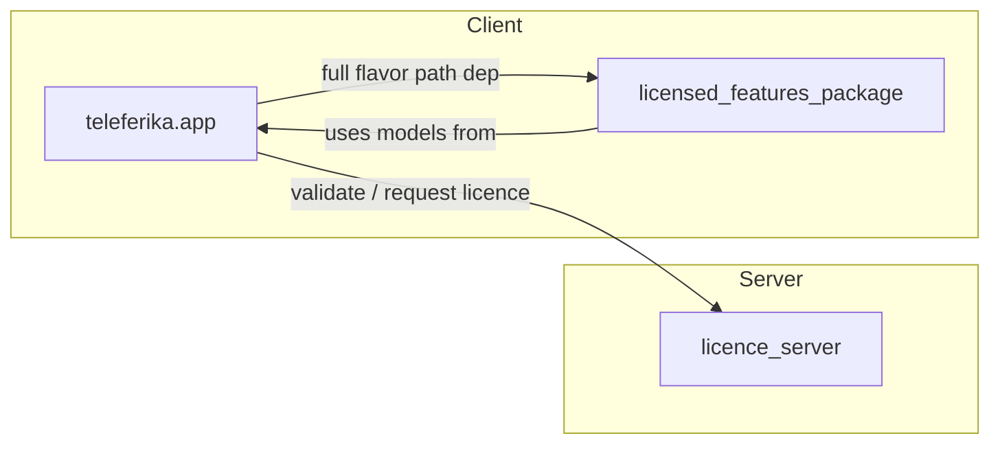

---
tags:
  - hub
  - teleferika
aliases:
  - Home
  - Teleferika Vault
---

# Teleferika Knowledge Vault

Living knowledge base for the **Teleferika** monorepo: cable crane / ropeway line planning for forest operations.

> Open this folder as an Obsidian vault (`File → Open vault` → select `obsidian-vault/`).

## Start here

| Note | Purpose |
|------|---------|
| [[Teleferika]] | What the product is and who it serves |
| [[Project Structure]] | Monorepo layout and submodules |
| [[Layered Architecture]] | How the Flutter app is layered |
| [[Current Features]] | Field-facing capabilities today |

## Maps of content (MOCs)

- [[Architecture MOC]] — layers, flavors, state, init flow
- [[Domains MOC]] — projects, points, map, BLE/RTK, licensing, DB, export
- [[Components MOC]] — `teleferika.app`, licensed package, licence server
- [[Concepts MOC]] — NMEA, NTRIP, Drift, fingerprints, magnetic north
- [[Development MOC]] — setup, FVM, scripts, debugging

## System at a glance

## Components

- [[teleferika.app]] — Flutter mobile app (GPS survey, map, projects)
- [[licensed_features_package]] — Premium export + offline map download
- [[licence_server]] — RSA-signed licences, admin web UI, REST API

## Domain quick links

[[Projects]] · [[Points]] · [[Map]] · [[Geometry]] · [[BLE RTK]] · [[Licensing]] · [[Database]] · [[Export]] · [[UI Screens]]

## Development

[[Setup]] · [[Flavors]] · [[FVM]] · [[Scripts]] · [[Debugging]] · [[Documentation Index]]

## Glossary

See [[Glossary]] for domain and tech terms.
