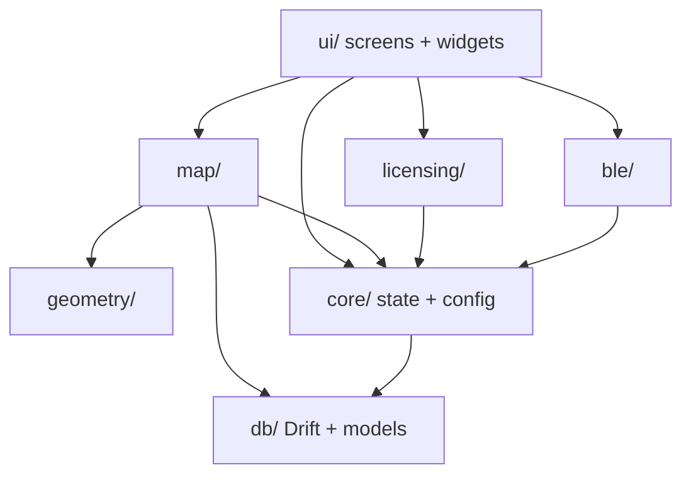

---
tags:
  - architecture
---

# Layered Architecture

`teleferika.app` follows a practical layered layout (documented in `main.dart`).

| Layer | Responsibility |
|-------|----------------|
| **UI** | Screens (`projects`, `points`, `map`, `settings`, `ble`, `loading`) and shared widgets |
| **Map** | Flutter Map orchestration, markers, cache, location/compass services |
| **Geometry** | Pure-ish math: bearings, distances, angles, polyline colors |
| **BLE** | RTK transports (BLE/USB), NMEA parse, NTRIP client |
| **Licensing** | Client licence storage/validation, feature plugins |
| **Core** | `AppConfig`, logging, `ProjectStateManager`, settings |
| **DB** | Drift schema (`schemaVersion` 8), `DriftDatabaseHelper`, models |

## Premium boundary

[[licensed_features_package]] plugs in via [[Feature Registry]] / `licensed_features_loader` — only in [[Flavors|full flavor]].

## Related

- [[App Initialization]] · [[State Management]] · [[teleferika.app]]
