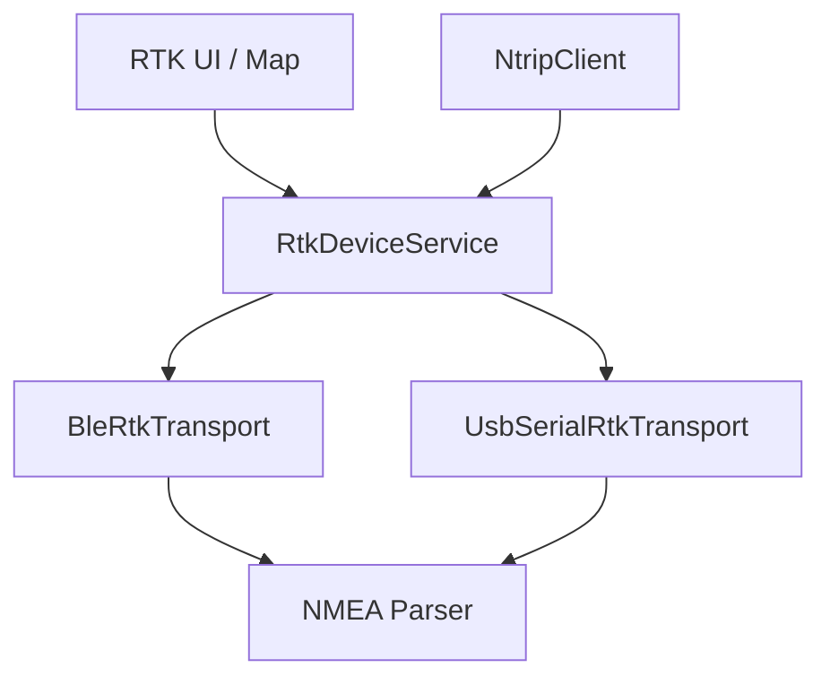

---
tags:
  - domain
  - ble
  - rtk
aliases:
  - RTK
---

# BLE RTK

Precision GNSS via external RTK receivers (e.g. ArduSimple RTK Handheld 2 Mapping Kit).

## Architecture (transport abstraction)

- **`RtkDeviceService`** — singleton façade; modes `ble` | `usb`
- **`BleService`** — Nordic UART–style NUS; streams raw bytes → NMEA
- **`UsbSerialService`** — Android USB serial ([[third_party usb_serial]])
- **`NmeaParser`** — GGA / RMC → `NMEAData` / `Position`
- **`NtripClient`** — corrections forwarder → [[NTRIP]]

## Fix quality

Fix quality from GGA (0 invalid, 1 GPS, 2 DGPS, 4 RTK fixed, 5 RTK float) drives [[fix Quality Colors]] / UI feedback.

## Docs

- `doc/ble/RTK_BLE_IMPLEMENTATION.md`
- `doc/ble/RTK_IMPROVEMENTS_RECOMMENDATIONS.md`
- USB investigation notes under `lib/ble/` and `doc/ble/`

## Related

- [[NMEA]] · [[Magnetic Variation]] · [[Map]] · [[Open Reminders]]
