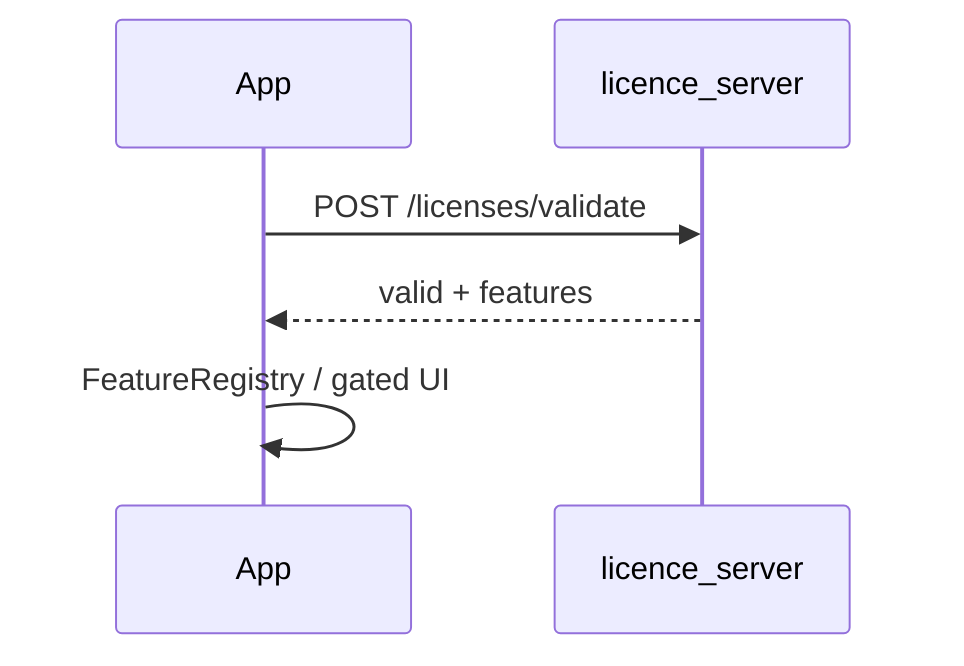

---
tags:
  - domain
  - licensing
---

# Licensing

Controls access to premium features in the **full** flavor.

## Client (`lib/licensing/`)

| File | Role |
|------|------|
| `licence_service.dart` | Load/store/validate; feature lists (`export_basic`, `export_advanced`, …) |
| `licence_model.dart` | Unified [[License Model]] |
| `cryptographic_validator.dart` | Verify RSA signature |
| `device_fingerprint.dart` | Bind licence to device → [[Device Fingerprint]] |
| `licence_request_service.dart` | Request licence from server |
| `feature_registry.dart` | Plugin registry → [[Feature Registry]] |
| `licensed_features_loader*.dart` | Full vs stub loader |

## Server

[[licence_server]] signs and stores licences; validates by email + fingerprint.

## Related

- [[RSA Licence Signing]] · [[licensed_features_package]] · [[License Request Workflow]] · [[Flavors]]
